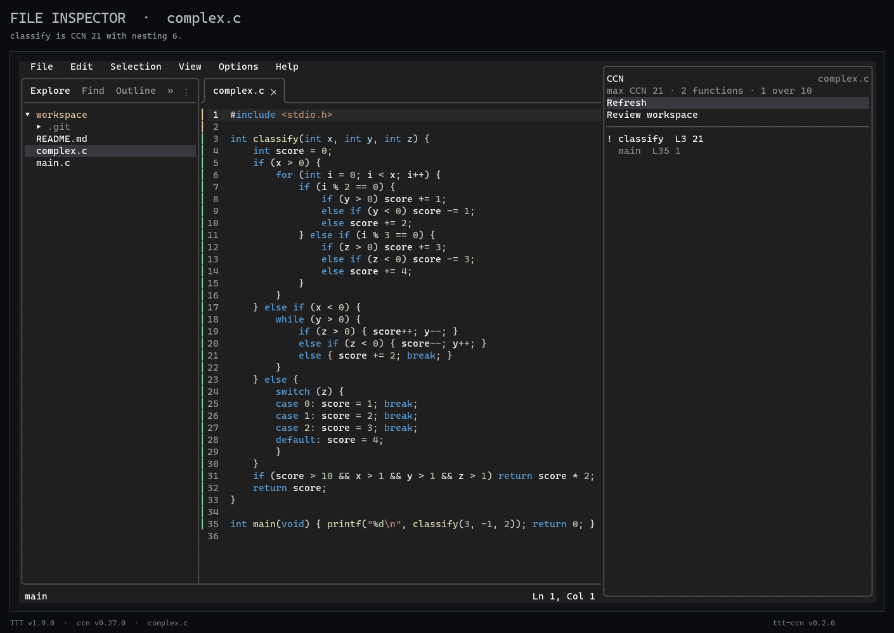
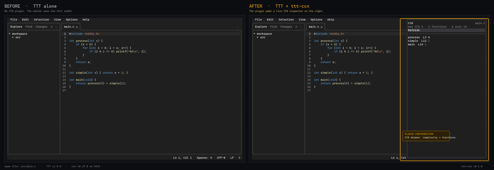
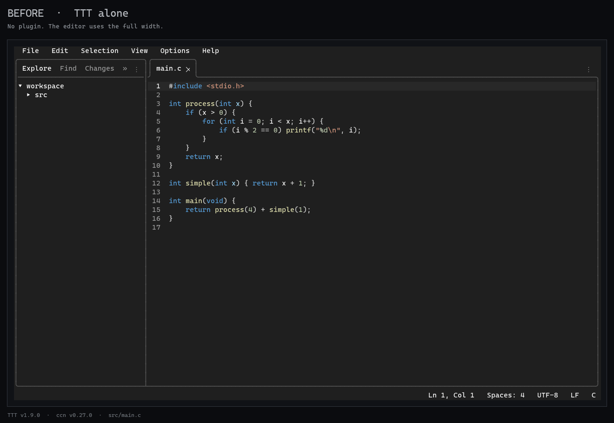

# ttt-ccn

**McCabe complexity and function inspection inside [TTT](https://github.com/eugenioenko/ttt).**

TTT already provides the terminal IDE: editor, LSP, Git, terminal, file tree and
a right-side drawer. This plugin adds complexity review on top of the
[`ccn`](https://github.com/Shinick-Han/ccn) binary:

- **File inspector** for the active file.
- **Workspace review** sorted by CCN across the repository.
- **Changed review** for functions added or worsened since a Git baseline.
- **Agent brief** that copies the top functions and their source ranges as
  Markdown, so an agent can start from pre-processed context.

```text
CCN review · workspace
5 files · 5 functions · 1 over 10
! complex.c:classify  L3   21
  main.c:process      L3    4
  complex.c:main      L35   1
```

Click a row to jump to its line. `!` marks functions above CCN 10. The status
item stays compact (`CCN review · 1 hot`).

## Review mode

Open the palette and run:

| Command | Purpose |
|---|---|
| `CCN: Review workspace` / `Alt+R` | Rank every measured function in the workspace |
| `CCN: Review changed (HEAD~1)` | Show functions added or worsened since `HEAD~1` |
| `CCN: Preview agent brief` | Render the current brief in the drawer |
| `CCN: Copy agent brief` | Copy the top functions, metrics, reasons and source snippets as Markdown |

`Copy agent brief` is deliberately mechanical: it reads the source ranges from
`ccn`'s JSON, caps the brief at 8 functions and 100 lines per function, and puts
it on the clipboard. It does not call an LLM or modify the workspace.

### Review demo

The same `complex.c` has `classify` at CCN 21. This loop shows file inspection,
workspace review, changed review, brief preview and copy:



Still frames: [workspace review](docs/images/review-workspace.png),
[changed review](docs/images/review-changed.png),
[agent brief](docs/images/agent-brief.png).

## Before / after

TTT alone uses the full editor width. With `ttt-ccn` loaded, the same file gets
a live CCN inspector in the right drawer:



The captures use the same `src/main.c`, TTT v1.9.0, and ccn v0.27.0. Only the
plugin differs. See the individual frames: [TTT alone](docs/images/ttt-alone.png)
and [TTT + ttt-ccn](docs/images/ttt-with-ccn.png).

### File inspector demo

The drawer auto-opens, closes with `Esc`, and reopens through
`Ctrl+P` → `CCN: Open inspector`:



## Requirements

- TTT **v1.9.0+**
- ccn **v0.27.0+** on `PATH`:
  - `npm install -g @shinick/ccn`
  - or download a release from <https://github.com/Shinick-Han/ccn/releases>
- Git on `PATH` for `Review changed` (`HEAD~1`); workspace review also works
  without Git and falls back to the active file's directory.
- A supported source file: C, C++, C#, Go, Java, JavaScript/JSX, Python, Rust,
  TypeScript/TSX.

Verify ccn first:

```console
$ ccn --version
$ ccn doctor
```

## Install

### TTT Plugins panel

Once the plugin is included in TTT's community registry, open the **Plugins**
sidebar tab, search for `CCN`, and install. The first load asks for approval of
the permissions listed below.

### Install from URL

In TTT: `Ctrl+P` → **Plugins: Install from URL**

```text
https://github.com/Shinick-Han/ttt-ccn
```

### Manual

User-wide:

```powershell
# Windows (run inside the cloned ttt-ccn directory)
$dest = "$HOME\.config\ttt\plugins\ttt-ccn"
New-Item -ItemType Directory $dest -Force | Out-Null
Copy-Item .\* $dest -Recurse -Force
```

```sh
# Linux / macOS
mkdir -p ~/.config/ttt/plugins
cp -R . ~/.config/ttt/plugins/ttt-ccn
```

Workspace-local:

```powershell
New-Item -ItemType Directory .\plugins -Force
Copy-Item -Recurse C:\path\to\ttt-ccn .\plugins\ttt-ccn
```

Then start TTT from the workspace:

```console
$ ttt . src/main.c
```

The inspector opens automatically for the first supported source file. Use
`Esc` to close the drawer.

## Commands and keys

| Input | Action |
|---|---|
| `Alt+C` | Open the file inspector |
| `Alt+R` | Open the workspace review |
| `Ctrl+P` → `CCN: Review workspace` | Rank workspace functions by CCN |
| `Ctrl+P` → `CCN: Review changed (HEAD~1)` | Show new/worsened functions since `HEAD~1` |
| `Ctrl+P` → `CCN: Copy agent brief` | Copy the current review as an agent brief |
| `Ctrl+P` → `CCN: Open inspector` | Open/reopen the file drawer |
| `Ctrl+P` → `CCN: Refresh` | Re-run the active view |
| `Ctrl+P` → `CCN: Close inspector` | Close the drawer |
| `Esc` | Close the drawer |
| Click a function row | Jump to that function's line |
| `Ctrl+Q` | Quit TTT |

## How it works

1. TTT reports the active file path.
2. File mode runs `ccn <absolute-path> --json` asynchronously.
3. Workspace review finds the Git root, runs `ccn <root> --json`, and flattens
   every `files[].ccn.detail[]` entry into one CCN-sorted list.
4. Changed review runs `ccn <root> --report-json --baseline HEAD~1` and reads
   `baseline.changes` (`ccn`, `base_ccn`, `kind`, `reasons`, line range).
5. The agent brief reads the source ranges and copies a capped Markdown digest.
6. The drawer renders the active list; clicking a row calls `ttt.open_file`.

It does not write workspace files, access the network, or change the editor
buffer. The manifest requests only:

- `panel.drawer`
- `commands`
- `keybindings`
- `editor.read`
- `fs.read` for source snippets in the workspace
- `events.file`
- `system.exec` for `ccn` / `ccn.exe` and `git` / `git.exe`

## Demo

A recording outline lives in [`docs/demo.md`](docs/demo.md). The repository
contains two fixtures:

- `demo/demo.c` — the original small file for the file inspector.
- `demo/complex.c` — a deliberately gnarly function (`classify`, CCN 21) for
  review mode.

`demo/ttt-ccn.tape` is the VHS scenario for the file inspector; review-mode
captures are in `docs/images/`.

## Limitations

This is still a review spike, not a full code-review product.

- Workspace review scans the whole Git root and can be slow on very large repos;
  `ccn`'s cache helps after the first run.
- Changed review is fixed to `HEAD~1`; Perforce changelists and arbitrary
  revisions are not exposed in the UI yet.
- The drawer shows sorted rows and a warning summary, not a full diff or inline
  annotations. `ccn lsp` remains the better surface for inline diagnostics.
- ccn's grammar support and heuristic limits apply unchanged.
- An unsaved `untitled` buffer is reported as an error rather than analyzed.

The next useful step is to pick the baseline revision from the palette, then
add an explicit "insert brief into an agent terminal" action.

## Development

```console
$ ttt . src/main.c
```

Use **Plugins: Reload** after editing `init.lua`. A workspace-local copy is the
fastest development loop; do not edit the installed user copy.

## License

MIT. See [LICENSE](LICENSE).

